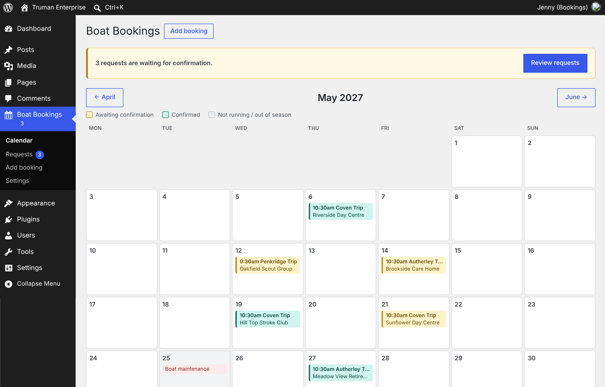
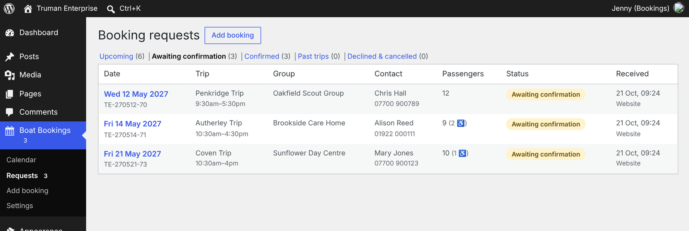
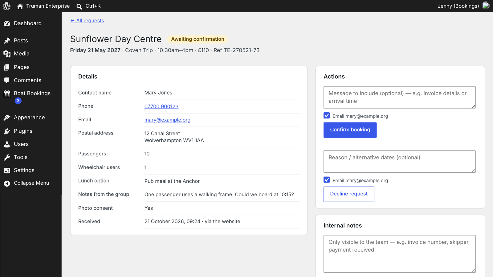
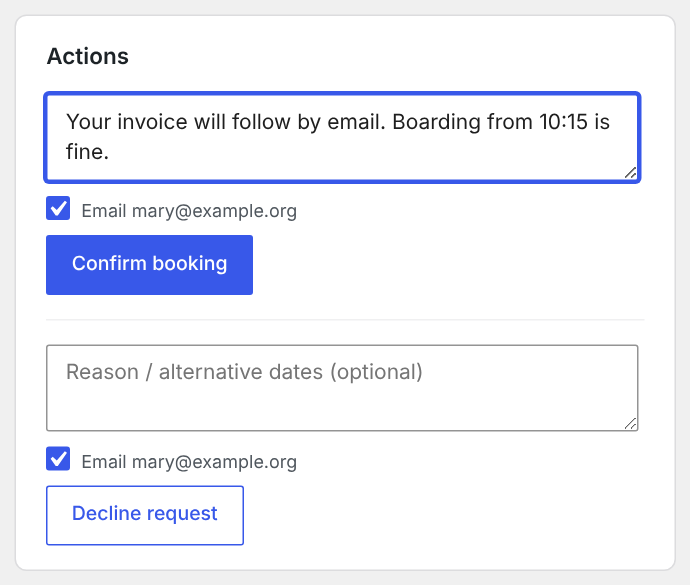
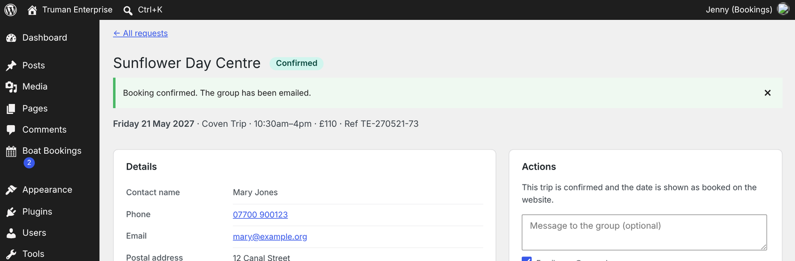
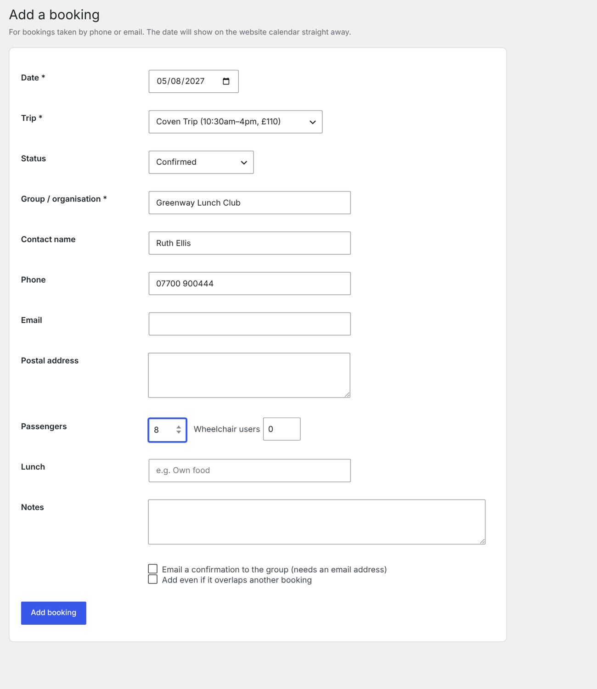
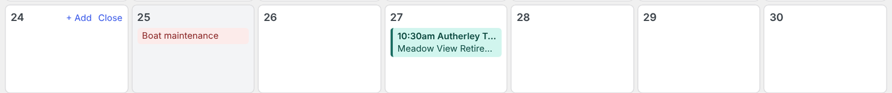
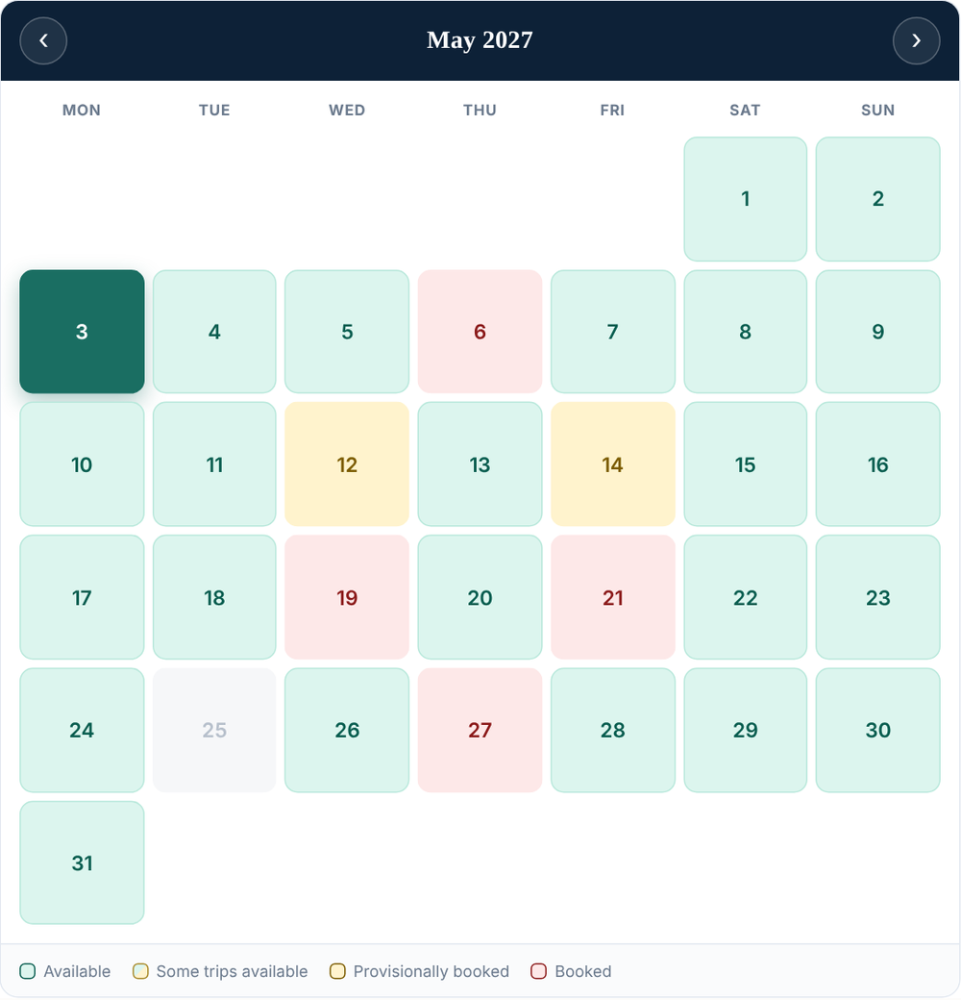
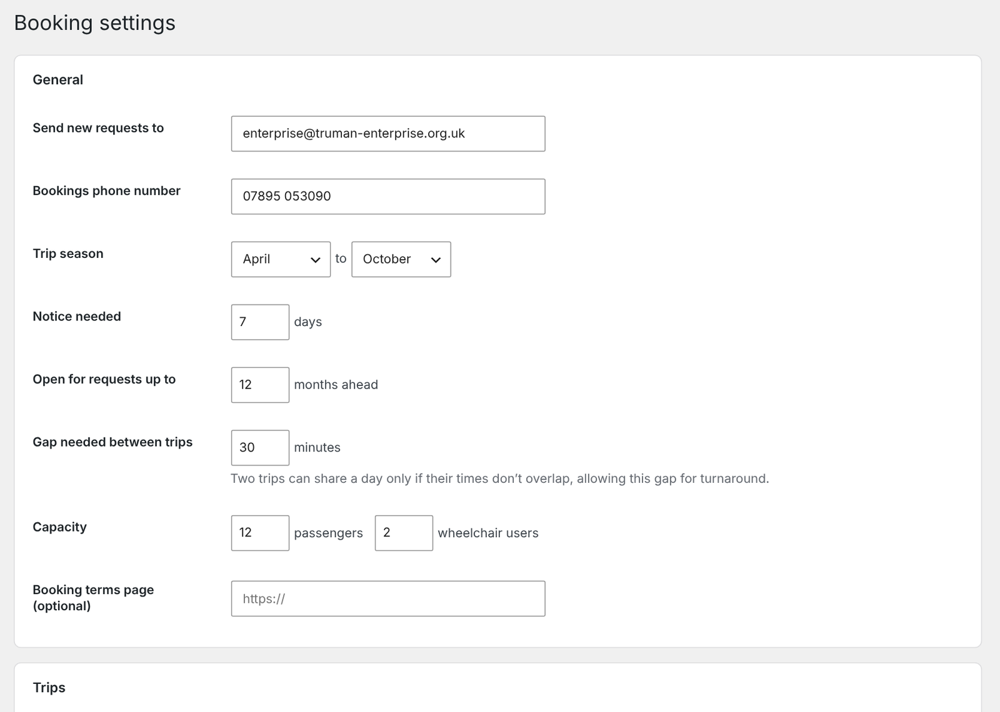

# Boat Bookings – Volunteer Guide

*Truman Enterprise Narrowboat Trust · October 2026*

When a group requests a trip on the website, the date is held as provisional and the bookings inbox gets an email. Your job is to confirm or decline it in WordPress — usually a two-minute task.

## 1. Getting started

1. Go to [truman-enterprise.org.uk/wp-admin](https://truman-enterprise.org.uk/wp-admin) and log in.
2. Click **Boat Bookings** in the left-hand menu. A blue number next to it means requests are waiting for you.
3. The **Calendar** opens. Yellow entries are waiting for confirmation; green entries are confirmed. Use the month buttons to move around.

Click any entry on the calendar to open that booking. The yellow banner's **Review requests** button lists everything waiting.

## 2. Confirming or declining a request

Every website request arrives as an email to the bookings inbox and appears here as **Awaiting confirmation**. While it waits, the date shows as provisional on the website so nobody else can take it.

1. Open **Boat Bookings → Requests**. The *Awaiting confirmation* tab lists everything to deal with, soonest first.

2. Click the date to open the request. Check the group's details, passenger numbers, wheelchair users and any notes.

3. To accept it, type an optional message (for example invoice details or arrival time) and click **Confirm booking**. Keep “Email …” ticked so the group is told.

4. The booking turns green, the group gets a confirmation email, and the date shows as **Booked** on the website.

To turn a request down, use **Decline request** instead and suggest another date in the message box. The date is freed up straight away.

To cancel a confirmed trip later, open it and click **Cancel booking**. Use **Internal notes** for anything only the team should see, such as the invoice number or skipper; every change is logged under **History**.

## 3. Adding a phone or email booking

When a group books by phone or email, add it yourself so the website calendar stays accurate.

1. Click **Boat Bookings → Add booking** (or hover over a day on the calendar and click **+ Add**).
2. Choose the date and trip, and leave the status as **Confirmed** if it's agreed.
3. Enter at least the group name, then any contact details you have.
4. Tick **Email a confirmation to the group** if you've entered their email and want them to get one.
5. Click **Add booking**. The date shows as booked on the website straight away.

If the trip overlaps an existing booking, you'll get a warning. Only tick **Add even if it overlaps** if you're sure.

## 4. Closing a day the boat isn't running

For maintenance days or when there's no crew, close the date so it can't be requested.

1. On the **Calendar**, hover over the day.
2. Click **Close**. The day is marked “Boat not running” and greys out on the website.
3. To reopen it, hover again and click **Open**.

Months outside the trip season (currently April to October) are closed automatically, so there's no need to close them one by one.

## 5. What visitors see

The **Book a Trip** page shows the same bookings as colours, so groups can see what's free before they ask.

| Colour | Meaning |
| --- | --- |
| Green | Free — all trips available |
| Green and yellow | Part-booked — a shorter trip may still fit |
| Yellow | Provisionally booked — a request is waiting for you |
| Red | Booked — confirmed |
| Grey | Not running, out of season, or less than 7 days away |

## 6. Settings (admins only)

**Boat Bookings → Settings** controls how the calendar behaves. Only administrators can change it.

- **Send new requests to:** the inbox that gets request emails.
- **Trip season, notice and how far ahead:** which dates people can request.
- **Gap needed between trips:** two trips share a day only if their times don't overlap, plus this gap.
- **Trips:** names, prices, times, descriptions and lunch options. Untick **Show** to stop offering a trip; existing bookings are kept. Fill in the blank row to add a new trip.

## Quick reference

| I want to… | Go to |
| --- | --- |
| See what's booked | Boat Bookings → Calendar |
| Deal with new requests | Boat Bookings → Requests → Awaiting confirmation |
| Confirm, decline or cancel | Open the booking → Actions |
| Add a phone booking | Boat Bookings → Add booking |
| Stop a date being booked | Calendar → hover the day → Close |
| Add a note (invoice no., skipper) | Open the booking → Internal notes |
| Change prices or trip times | Boat Bookings → Settings (admins) |

Replying to a request email goes straight to the group. Screenshots in this guide use example bookings.
