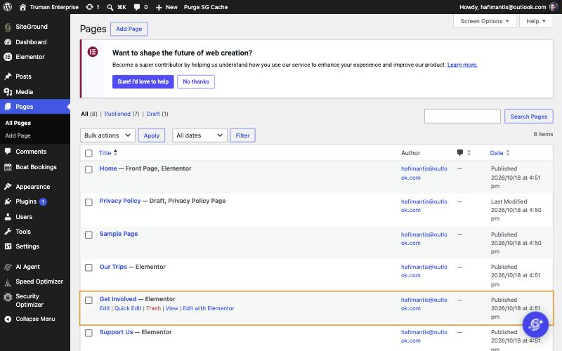
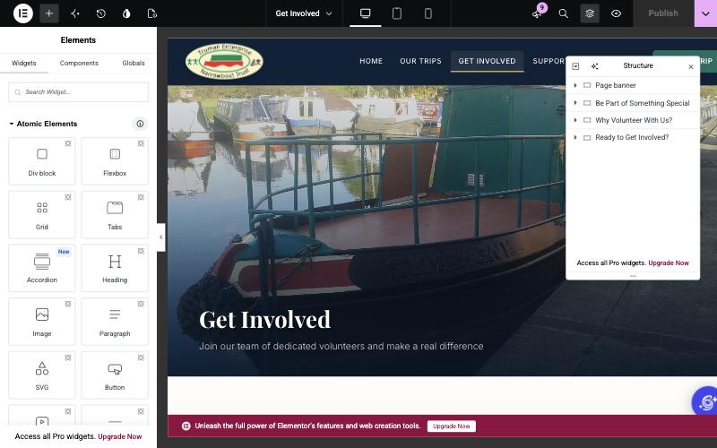
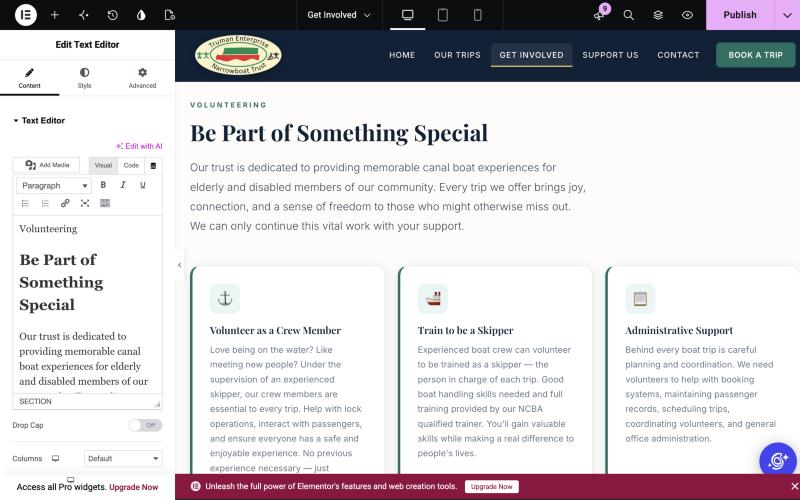
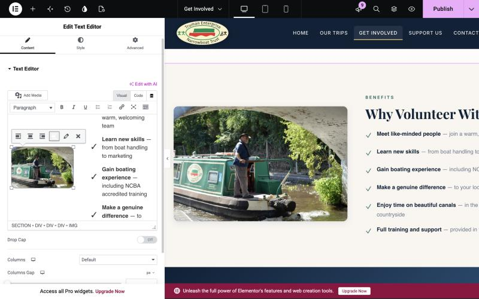
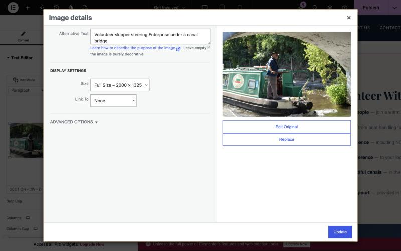
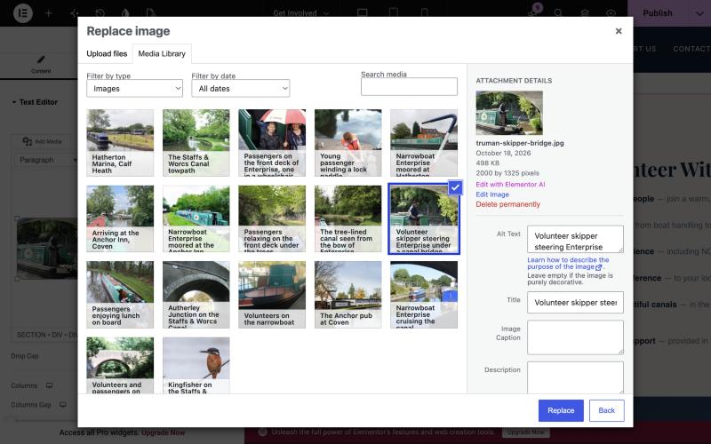
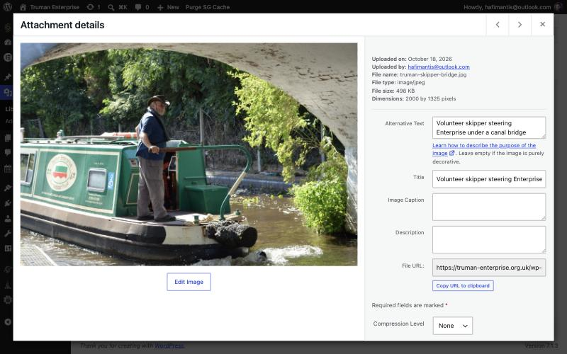
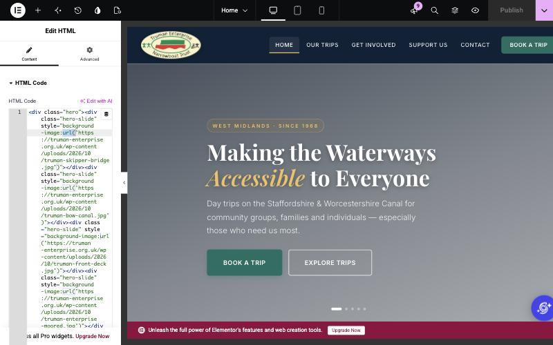

# Editing the Website – Volunteer Guide

*Truman Enterprise Narrowboat Trust · October 2026*

## Before you start

This guide covers the simple jobs: **changing wording** and **swapping photos** on the six main pages (Home, Our Trips, Get Involved, Support Us, Contact, Book a Trip). For the booking calendar, see the [Boat Bookings guide](boat-bookings-guide.md).

Log in at **truman-enterprise.org.uk/wp-admin** with your own account.

Three golden rules:

1. **Nothing goes live until you press Publish.** You can try things out and close the tab to throw them away.
2. **Change one thing, Publish, then check the live page.** Small steps are easy to undo.
3. **Only use photos we have consent for.** This applies to any photo with passengers or volunteers in it.

## 1. Open a page in Elementor

1. In the left-hand menu go to **Pages → All Pages**.
2. Hover over the page you want, e.g. *Get Involved*, and click **Edit with Elementor**.

The editor opens. The **left panel** holds the settings for whatever you click. The **right side** is a live preview of the page.

**Tip:** the layers icon at the top right opens **Structure**, a list of the page's sections by name (e.g. *Why Volunteer With Us?*). Click a name to jump to that section.

**Tip:** if the left panel feels cramped, drag its right-hand edge to make it wider.

## 2. Change text

1. In the preview, click the section with the wording you want to change. The left panel becomes **Edit Text Editor**.
2. Make sure the **Visual** tab is selected (not *Code*).
3. Click into the text box and edit it like a normal document: type, delete, **B** for bold, the link icon for links. The preview updates as you type.

You can also click straight into the words on the preview and type there.

**Good to know:**

- Each section's small label (e.g. *Volunteering*), heading and paragraphs are all in the same box. The box looks plainer than the website, but the site's styling is kept.
- Keep headings as headings. If the dropdown says *Heading 2*, leave it.
- Don't paste straight from Word, which brings hidden formatting with it. Paste with **Ctrl+Shift+V** (Mac: **Cmd+Shift+V**) to paste plain text.

## 3. Swap a photo

The photos inside sections (e.g. the skipper photo next to *Why Volunteer With Us?*) are swapped from the text box.

1. Click the section with the photo. In the left panel's text box (Visual tab), scroll to the small copy of the photo and **click it**. A little toolbar appears above it.
2. Click the **pencil** icon.

3. The **Image details** window opens. Update the **Alternative Text** to describe the new photo, which helps people using screen readers. Leave **Size** on *Full Size*. Then click **Replace**.

4. Pick the new photo from the **Media Library**. To use a new photo, go to the **Upload files** tab first. Click **Replace**, then **Update**.

The new photo takes the same place, shape and rounded corners as the old one.

**Photo tips:**

- Landscape photos work best. Aim for about 2000 pixels wide or less, since phone photos can be very large.
- Photos can be uploaded ahead of time in **Media → Add New Media File**.

## 4. Change the slideshow photos on Home

The big rotating photos at the top of the Home page work differently. They're stored as web addresses, so you swap the address. Take it slowly, and if anything looks wrong, close the tab without publishing.

**Get the new photo's address:**

1. Go to **Media → Library**, upload the photo if needed, and click it.
2. Click **Copy URL to clipboard**.

**Swap it in:**

1. Open **Home** with Elementor and click the slideshow. The panel shows **Edit HTML** with code in it.
2. Each slide is a line containing `background-image:url('https://truman-enterprise.org.uk/wp-content/uploads/…/truman-….jpg')`. The slides run in order, so the first address is the first slide.
3. Select **only** the address between the quote marks `' '`, from `https` to `.jpg`, and paste the new one over it. Don't touch anything else.

4. Check the preview, then **Publish**.

The big banner photos at the top of the other pages are ordinary photos, so swap those the normal way (section 3).

## 5. Save, check, undo

- **Publish** (top right, it turns pink when there are changes) makes your changes live.
- **Preview:** the eye icon at the top shows the page as visitors will see it, before publishing.
- **Check on a phone:** the phone and tablet icons at the top show the mobile layout.
- **Undo:** press **Ctrl+Z** (Mac: **Cmd+Z**). For bigger mistakes, open the **History** clock icon at the top, then **Revisions**, to go back to an earlier saved version.
- **Throw away everything:** close the tab without publishing.

After publishing, open the live page. If you don't see the change, press **Purge SG Cache** in the black bar at the top of the admin, then refresh.

## Leave these alone

- **Header and footer** (logo, menu, footer contact details) are part of the theme and can't be edited in Elementor. Ask the web admin.
- **Menu links:** **Appearance → Menus**.
- **The booking form and calendar** on *Book a Trip* and *Our Trips* show up in the editor as `[truman_booking]` / `[truman_availability]`. Don't edit or delete those. Trips, prices and dates are changed in **Boat Bookings → Settings**.
- **Don't** drag in new sections or change colours, fonts or spacing. Ask first.
- **Don't** delete photos from the Media Library. A page may still be using them.
